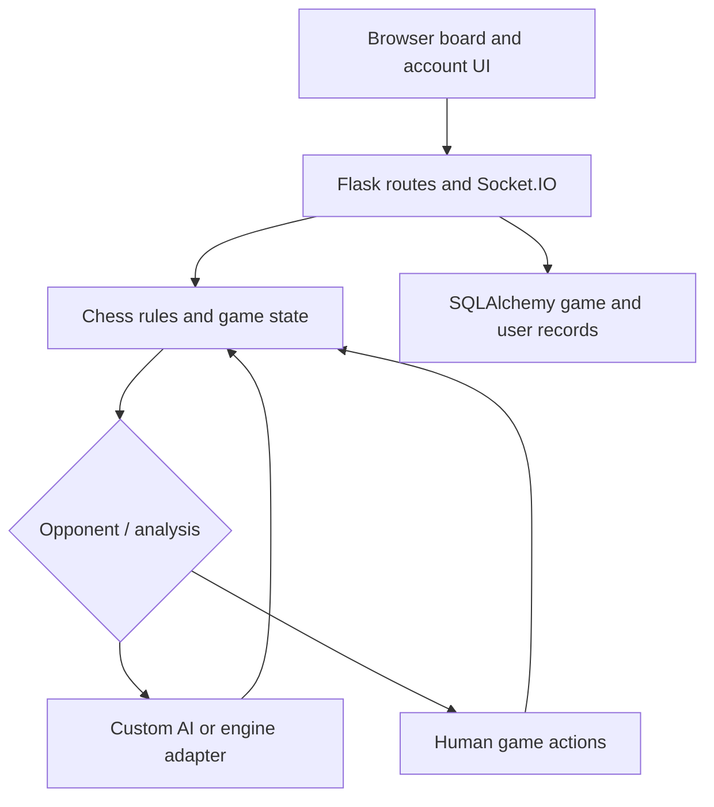

# Flask Chess — Accounts, Games, and Analysis

Flask chess application with user accounts, Socket.IO game events, persistent game records, a custom chess AI, and optional engine-based analysis.

## Project focus

Flask application. The sections below separate the runnable entry point, source layout, prerequisites, and verification path.

## Architecture



## Repository structure

| Path | Purpose |
| --- | --- |
| [`LICENSE`](LICENSE) | Repository licensing terms. |
| [`ai.py`](ai.py) | Python application helper or learning example. |
| [`analysis.py`](analysis.py) | Python application helper or learning example. |
| [`app.py`](app.py) | Application entry point or route definitions. |
| [`backup.json`](backup.json) | Dataset, fixture, state, or database file; inspect its schema before use. |
| [`chess_logic.py`](chess_logic.py) | Python application helper or learning example. |
| [`instance/`](instance) | Local application database files. |
| [`migrations/`](migrations) | Database migration definitions. |
| [`models.py`](models.py) | Python application helper or learning example. |
| [`requirements.txt`](requirements.txt) | Python dependency manifest. |
| [`static/`](static) | Browser styles, scripts, and static assets. |
| [`templates/`](templates) | Server-rendered HTML templates. |

## Getting started

```bash
git clone https://github.com/Raimal-Raja/chess.git
cd chess
```

```bash
python -m venv .venv
source .venv/bin/activate
```

On Windows PowerShell, activate the environment with `.venv\Scripts\Activate.ps1` instead.

```bash
python -m pip install -r requirements.txt
```

```bash
python app.py
```

## Configuration and scope

This is the repository owner's implementation, not the chess.com service. Supply a compatible external engine if you enable engine-based analysis. The current requirements now list this application's imports rather than an unrelated workstation freeze.

## Verification

Use the setup commands and inspect the selected interface, example, or notebook with known inputs. This documentation review checks repository paths and dependency declarations; it does not claim fresh end-to-end execution or model-quality measurements.

## Contributing

Include reproduction steps, the affected path, expected behavior, and the checks you ran. Keep credentials, generated environments, and unnecessary build artifacts out of commits.

## License

See [LICENSE](LICENSE) for the repository's license.
